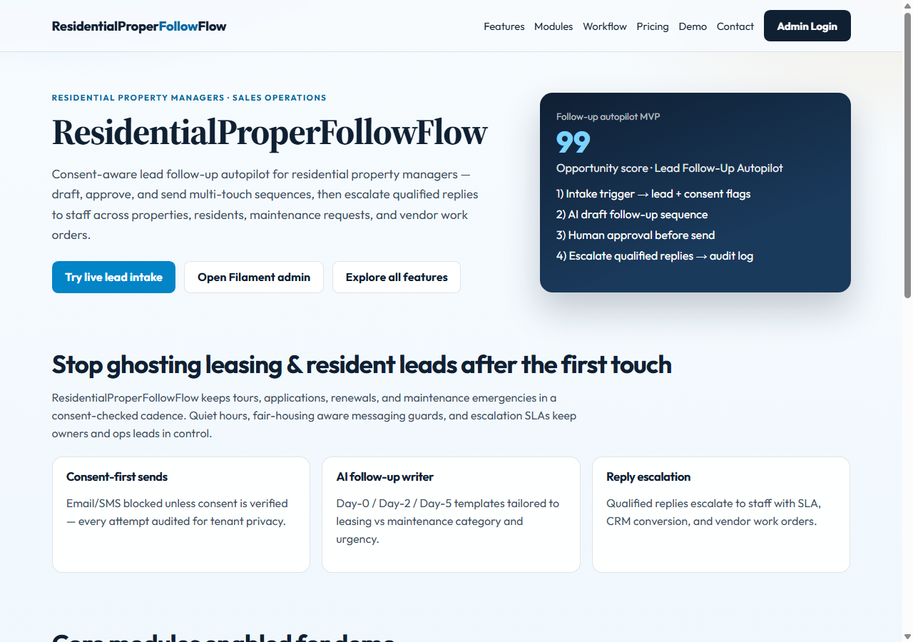
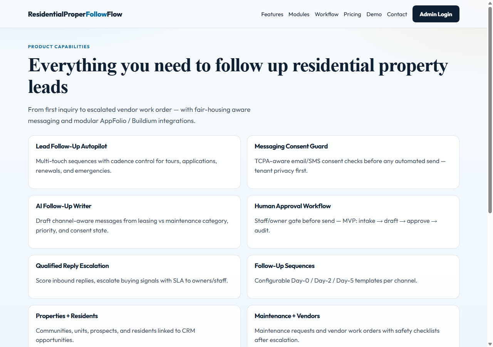
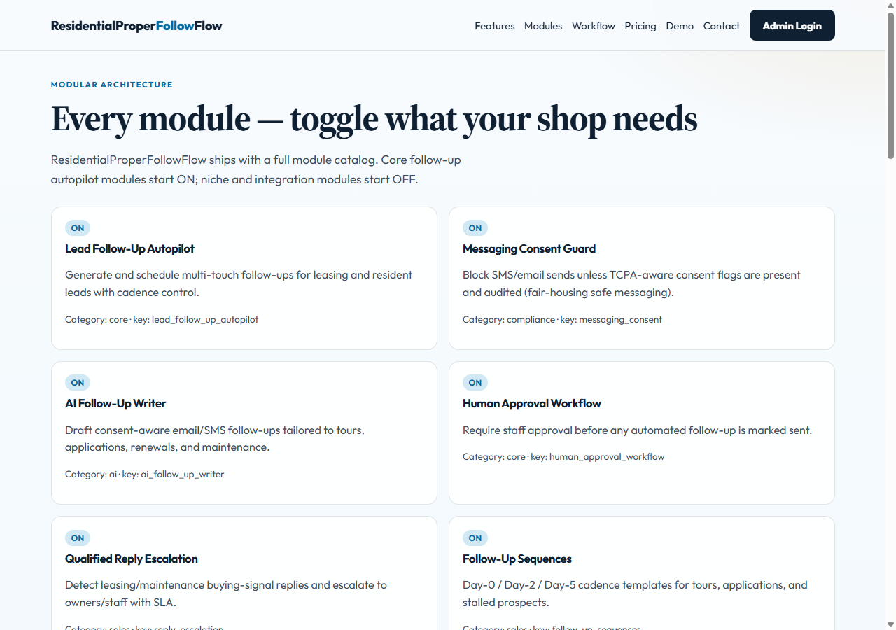
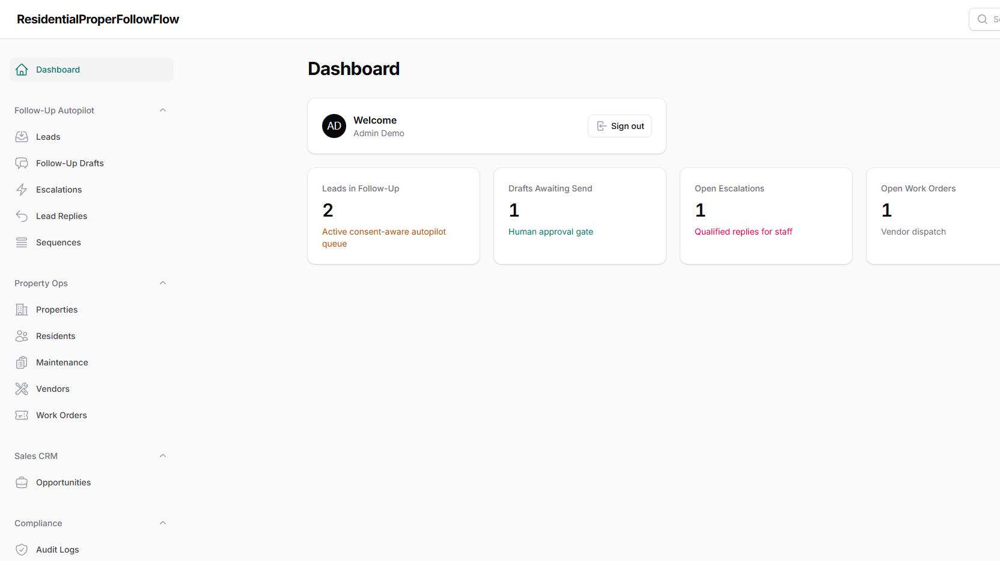
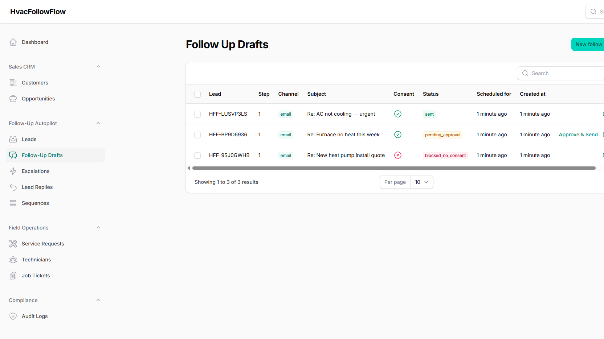
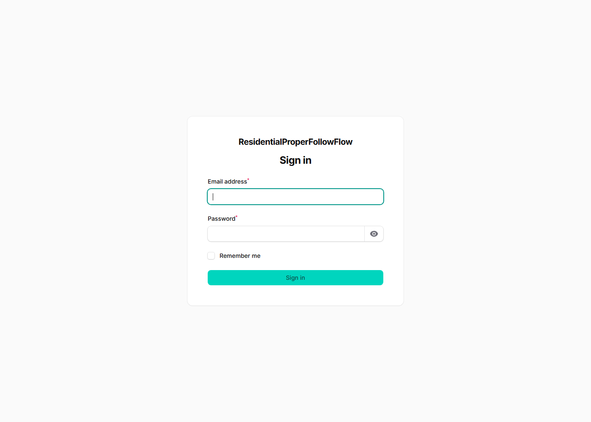

# CommercialPropertFollowFlow — AI Lead Follow-Up Autopilot for Commercial Property Managers

**CommercialPropertFollowFlow** is a modular Laravel + Filament SaaS that helps commercial property manager owners and operations leads **generate and send consent-aware follow-ups**, **escalate qualified replies to staff**, and operate on **properties, residents, maintenance requests, and vendor work orders**.

Built for the USA Real Estate & Property sector — sales operations workflow with human-in-the-loop AI drafts, TCPA-aware messaging consent, fair-housing awareness, quiet hours, and a full ON/OFF module catalog.

## Local demo

- **App URL:** http://localhost:8143
- **Admin:** http://localhost:8143/admin
- **MySQL:** localhost:33113
- **Redis:** localhost:63833

```bash
cd pipeline/apps/CommercialPropertFollowFlow
docker compose up -d --build
```

Entrypoint runs `migrate` + `db:seed` automatically against MySQL (not SQLite).

## Demo users

Password for all: `password`

| Role | Email |
|------|-------|
| Admin | admin@commercialpropertfollowflow.test |
| Owner | owner@commercialpropertfollowflow.test |
| Staff | staff@commercialpropertfollowflow.test |
| Technician / Vendor | tech@commercialpropertfollowflow.test |
| Customer | customer@commercialpropertfollowflow.test (no admin panel) |

## Public pages

- `/` — Home / product story
- `/features` — Full feature catalog
- `/modules` — Every module ON/OFF
- `/workflow` — MVP intake → draft → approve → audit
- `/pricing` — Pilot $199–$799/mo
- `/demo` — Live lead intake form
- `/contact` — Hire / contact
- `/admin` — Filament admin

## Core workflow (MVP)

1. **Intake trigger** — website / phone / email / SMS / referral with consent flags  
2. **AI classify + draft** — leasing vs maintenance category, priority, score, Day-0 follow-up  
3. **Human approval** — staff/owner gate; consent + quiet hours can block/defer  
4. **Send + await reply** — audited send; cadence stamp  
5. **Escalate qualified replies** — SLA escalation → CRM opportunity + maintenance request  
6. **Vendor work orders** — dispatch vendors with safety checklists  

## Modules

Toggle in Filament **Module Settings** (synced from `config/modules.php`).

**Core ON:** Lead Follow-Up Autopilot, Messaging Consent Guard, AI Follow-Up Writer, Human Approval, Reply Escalation, Sequences, Inbound Lead Intake, AI Classification, CRM Opportunities, Properties, Residents & Prospects, Maintenance Requests, Vendors, Vendor Work Orders, Audit Log, Quiet Hours, Fair Housing Guard, AI Hub, Drutogoti Speed, Admin Panel Extras, Slug Engine.

**Niche OFF by default:** Tenant Portal, Attendance Hub, Unicode PDF Exports, AI Catalog Scrape, AppFolio, Buildium, Email Integration, Accounting Integration, Multi-Property Portfolio.

> Packagist `imrandevbd/*` packages are not required as stable Composer deps for Laravel 13 — local service equivalents ship for AI Hub, Admin Panel extras, Slug, Attendance, Unicode PDF, AI Catalog, and Drutogoti speed helpers.

## Tech stack

- PHP 8.4 · Laravel 13 · Filament 4  
- MySQL 8.4 · Redis 7  
- Docker Compose (`ext-intl` installed for Filament)  
- Modular feature flags · Multi-role users · AI assist hooks  

## Screenshots













## Related keywords / SEO tags

### Business category & sector
commercial property managers, commercial property management software, Class A office leasing CRM, retail plaza property ops, industrial warehouse leasing follow-up, mixed-use commercial portfolio, Real Estate & Property USA, commercial multifamily ops, CRE property manager SaaS, owner / operations lead tooling

### Workflow & sales operations
lead follow-up autopilot, consent-aware follow-ups, leasing tour nurture, lease application follow-up, LOI pipeline nurture, sales operations automation, inbound inquiry triage, reply escalation SLA, human approval gate, Day-0 Day-2 Day-5 cadence, quiet hours messaging, TCPA property management messaging, fair housing messaging guard, tenant privacy audit log, email drip leasing, SMS leasing nudge

### Property ops modules
properties residents prospects, resident maintenance requests, vendor work orders, vendor dispatch checklist, maintenance emergency triage, suite tour scheduling, CAM / renewal conversations, multi-property portfolio toggle, AppFolio follow-up workflow, Buildium maintenance escalation, email integration, accounting property leads

### Product & stack keywords
Laravel Filament SaaS, PHP Laravel 13, Filament 4 admin, Docker Compose MySQL Redis, modular feature flags ON/OFF, multi-role admin owner staff technician customer, AI business automation 2026, AI follow-up writer, AI classification hub, audit log compliance, commercial property managers lead follow-up autopilot, CommercialPropertFollowFlow, IMRAN Dev BD Laravel Filament

## Integrations (module toggles)

AppFolio · Buildium · Email · Accounting

## Risk / compliance

MED/HIGH — housing, fair-housing and tenant privacy. Consent guard, quiet hours, fair-housing flag, and immutable audit log are ON by default for the demo.

## Author

Git commits are authored only as **Imran Ahmed &lt;me@imrandev.bd&gt;**. No GitHub Actions workflows ship with this repo.

## Contact / Hire

- Developer: Imran Ahmed (IMRAN Dev BD)
- Website: https://imrandev.bd/contact
- Email: me@imrandev.bd
- GitHub: https://github.com/imranbru99
